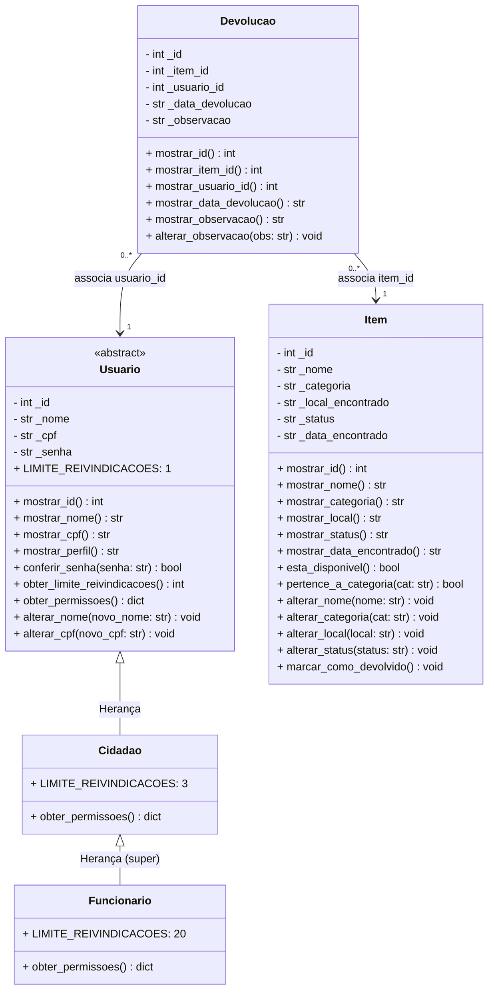

# 🔍 Sistema de Achados e Perdidos API - Prova 1 POO

Backend desenvolvido para a disciplina de **Programação Orientada a Objetos (POO)**, aplicando arquitetura em camadas **MVC (Model-View-Controller)** com **FastAPI**, com foco rigoroso em **Encapsulamento**, **Herança**, **Polimorfismo** e **Desacoplamento Arquitetural**.

---

## 🏗️ Arquitetura do Sistema

A aplicação adota separação estrita em 4 camadas e direção única de dependência (_top-down_):

$$\text{main.py} \longrightarrow \text{routes (View)} \longrightarrow \text{controllers} \longrightarrow \text{models} \longrightarrow \text{data (Mock)}$$

- **`app/data/`**: Dados mockados em listas puras de dicionários Python (`itens_mock.py`, `usuarios_mock.py`, `devolucoes_mock.py`). Sem classes, sem regras e sem nenhum import.
- **`app/models/`**: Domínio puro e regras de negócio (`item.py`, `usuario.py`, `devolucao.py`). Todos os atributos protegidos com `_`, validações com `raise ValueError`, polimorfismo e **zero dependência de FastAPI ou HTTP**.
- **`app/controllers/`**: Orquestração dos casos de uso (`item_controller.py`, `auth_controller.py`, `devolucao_controller.py`). Converte objetos para dicionário via `_para_dicionario()`, usa compreensão de lista e devolve `None`/lista vazia quando não encontra (nunca código HTTP).
- **`app/routes/`**: Endpoints HTTP com FastAPI (`item_routes.py`, `auth_routes.py`, `devolucao_routes.py`). Traduz exceções e estados para códigos de status padronizados (200, 201, 401, 404, 409, 422).
- **`main.py`**: Ponto de entrada, configura CORS e inclui os roteadores.

---

## 🚀 Como Rodar o Projeto

### 1. Clonar ou Acessar a Pasta do Projeto

```bash
cd AchadosPerdidosPOO
```

### 2. Criar e Ativar o Ambiente Virtual (Recomendado)

- **Windows (PowerShell):**
  ```powershell
  python -m venv .venv
  .venv\Scripts\activate
  ```
- **Linux / MacOS:**
  ```bash
  python3 -m venv .venv
  source .venv/bin/activate
  ```

### 3. Instalar as Dependências

```bash
pip install -r requirements.txt
```

### 4. Executar a Bateria de Verificação Automatizada

Para validar os 15 critérios arquiteturais, de herança e de rotas:

```bash
python verificar.py
```

_(Todos os 15 testes passam com 100% de sucesso)._

### 5. Iniciar o Servidor FastAPI

```bash
python -m uvicorn main:app --reload
```

> **Nota:** Caso a porta 8000 já esteja em uso na sua máquina (erro `WinError 10013`), suba especificando outra porta livre (como 8001):
>
> ```bash
> python -m uvicorn main:app --reload --port 8001
> ```

A API estará disponível em: **http://127.0.0.1:8000** (ou **http://127.0.0.1:8001**)  
Documentação interativa Swagger: **http://127.0.0.1:8000/docs** (ou **/docs** na porta escolhida)

---

## 📊 Diagrama de Classes UML

O sistema conta com 5 classes no total (respeitando o limite de 3 a 5 classes), com hierarquia de 2 níveis em `Usuario`:



---

## 📡 Tabela de Rotas da API

| Método | Endpoint                        | Descrição                                   | Códigos HTTP               |
| ------ | ------------------------------- | ------------------------------------------- | -------------------------- |
| `GET`  | `/`                             | Informações da API e link para o `/docs`    | `200`                      |
| `GET`  | `/api/itens`                    | Lista todo o acervo de itens achados        | `200`                      |
| `GET`  | `/api/itens/disponiveis`        | Lista apenas itens com status `guardado`    | `200`                      |
| `GET`  | `/api/itens/categoria/{cat}`    | Filtra itens por categoria                  | `200`, `404`               |
| `GET`  | `/api/itens/{id}`               | Busca um item específico pelo ID            | `200`, `404`               |
| `POST` | `/api/itens`                    | Cadastra um novo item encontrado            | `201`, `422`               |
| `POST` | `/api/devolucoes`               | Registra a devolução do item ao cidadão     | `201`, `404`, `409`, `422` |
| `GET`  | `/api/devolucoes`               | Lista todas as devoluções já realizadas     | `200`                      |
| `GET`  | `/api/devolucoes/{id}`          | Detalhes de um registro de devolução        | `200`, `404`               |
| `GET`  | `/api/usuarios/{id}/devolucoes` | Histórico de devoluções por usuário         | `200`, `404`               |
| `POST` | `/api/auth/login`               | Autentica e retorna perfil polimórfico      | `200`, `401`               |
| `GET`  | `/api/itens/relatorio/status`   | Totalizador de itens guardados e devolvidos | `200`                      |

---

## 👥 Divisão da Equipe (Quem Fez o Quê)

| Integrante | Papel / Responsabilidade Principal                                                                                                                                                                                            |
| ---------- | ----------------------------------------------------------------------------------------------------------------------------------------------------------------------------------------------------------------------------- |
| **Arthur** | Modelagem do Domínio (`Item`, `Usuario`, `Devolucao`), Encapsulamento, Regras de Negócio (`ValueError`), Hierarquia de Herança, Polimorfismo (`super()`) e Constantes de Classe.                                              |
| **Bianca** | Camada de Controllers (`ItemController`, `AuthController`, `DevolucaoController`), Camada de Routes com FastAPI, tratamento de status HTTP (200, 201, 401, 404, 409, 422), Mocks da camada `data/` e testes (`verificar.py`). |

---

## 📋 Saída da Execução do `verificar.py`

```text
======================================================================
 BATERIA DE VERIFICAÇÃO AUTOMATIZADA: SISTEMA ACHADOS E PERDIDOS
======================================================================
[PASSOU] 01. Hierarquia com 3 classes e 2 níveis validada
[PASSOU] 02. Método sobrescrito com super() estendendo comportamento da base validado
[PASSOU] 03. Constante de classe com valores polimórficos nas filhas validada
[PASSOU] 04. Mapeamento de texto do mock para classes via dicionário sem if validado
[PASSOU] 05. Polimorfismo de permissões respondendo sem if validado
[PASSOU] 06. Encapsulamento com atributos protegidos (_) e métodos mostrar_ validado
[PASSOU] 07. Regra rígida: nenhum alterar_id e senha protegida sem método de leitura
[PASSOU] 08. Construtores chamando métodos alterar_ para garantir validação validado
[PASSOU] 09. Regras de negócio com raise ValueError validadas (7 regras testadas)
[PASSOU] 10. Método __repr__ implementado em todas as classes
[PASSOU] 11. Camada Models 100% pura: sem nenhuma dependência do FastAPI ou HTTP
[PASSOU] 12. Camada Controllers 100% desacoplada de HTTP
[PASSOU] 13. Filtros com compreensão de lista nos controllers validados
[PASSOU] 14. Controllers devolvem None ou lista vazia, nunca códigos HTTP
[PASSOU] 15. Rotas HTTP testadas com TestClient (200, 201, 401, 404, 409 e 422)
======================================================================
 TODOS OS 15 TESTES PASSARAM COM 100% DE SUCESSO!
 PROJETO TOTALMENTE EM CONFORMIDADE COM A RUBRICA DA PROVA 1 (POO)!
======================================================================
```
